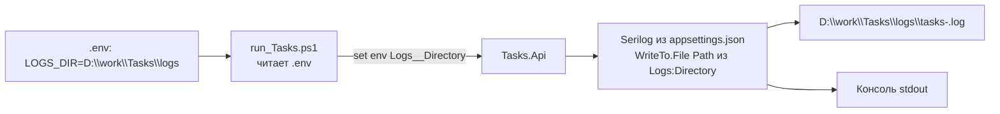

# План: файловое логирование в D:\work\Tasks\logs через Serilog

> Целевой проект: `src/Tasks/Tasks.Api`
> Задача: писать логи приложения в файл, каталог брать из `.env` (`LOGS_DIR`),
> при запуске через [`run_Tasks.ps1`](src/run_Tasks.ps1:1).
> Сохранить текущее поведение: логи по-прежнему идут в консоль.

---

## 1. Проверка доступности пакетов (выполнено)

Офлайн-источник проекта — [`NuGet.Config`](src/Tasks/NuGet.Config:11) (`../../local-packages`),
но там **пакетов логирования нет**. Локальный кэш NuGet (`C:\Users\Dionis\.nuget\packages`)
содержит всё необходимое, restore берёт оттуда (см. комментарий в NuGet.Config).

| Пакет | Версия | net10.0 | Роль |
|-------|--------|---------|------|
| `Serilog` | 4.4.0 | да | Ядро |
| `Serilog.Sinks.File` | 7.0.0 | да | Запись в файл |
| `Serilog.Sinks.Console` | 6.1.1 | да | Консоль (текущее поведение) |
| `Serilog.Extensions.Hosting` | 10.0.0 | да | Интеграция с Generic Host |
| `Serilog.Extensions.Logging` | 10.0.0 | да | Мост в `Microsoft.Extensions.Logging` |
| `Serilog.Settings.Configuration` | 10.0.1 | да | Чтение секции `Serilog` из `appsettings.json` |

**Вывод:** выбран вариант **Serilog** — пакеты уже в локальном кэше, поддержка net10.0,
конфигурация из `appsettings.json`, встроенный rolling. Кастомный `ILoggerProvider`
не нужен.

---

## 2. Схема

---

## 3. Шаги реализации

### Шаг 1. Зависимости
- В [`Tasks.Api.csproj`](src/Tasks/Tasks.Api/Tasks.Api.csproj:11) добавить:
  - `Serilog` 4.4.0
  - `Serilog.Sinks.File` 7.0.0
  - `Serilog.Sinks.Console` 6.1.1
  - `Serilog.Extensions.Hosting` 10.0.0
  - `Serilog.Settings.Configuration` 10.0.1
- Проверить restore (`dotnet restore`) — все пакеты должны подтянуться из кэша.

### Шаг 2. Конфигурация в appsettings.json
- В [`appsettings.json`](src/Tasks/Tasks.Api/appsettings.json:2) добавить секцию `Serilog`:
  - `Using` (namespaces-сборки sinks)
  - `MinimumLevel` (перенести уровни; можно оставить и старую `Logging`)
  - `WriteTo`: Console + File с `path` вида `%LOGS_DIR%/tasks-.log`, rolling
    (`rollingInterval: Day`, `retainedFileCountLimit`), общий шаблон.
- Значение пути **не хардкодить** — подставлять из конфигурации (`Logs:Directory`).

### Шаг 3. Проброс каталога из .env
- В [`.env`](.env:43) и [`.env.example`](.env.example:44) `LOGS_DIR` уже есть.
- Вариант A (рекомендуемый): в [`run_Tasks.ps1`](src/run_Tasks.ps1:118) после
  загрузки `.env` продублировать значение под ключом конфигурации .NET, который читает
  приложение — `Logs__Directory` = `$envVars['LOGS_DIR']`. Это надёжно привязывает
  `LOGS_DIR` к `Logs:Directory`.
- Каталог уже создаётся скриптом ([`run_Tasks.ps1`](src/run_Tasks.ps1:135)) — оставить.

### Шаг 4. Подключение Serilog в Program.cs
- В [`Program.cs`](src/Tasks/Tasks.Api/Program.cs:13):
  - `builder.Host.UseSerilog((ctx, cfg) => cfg.ReadFrom.Configuration(ctx.Configuration));`
  - Добавить fallback: если `Logs:Directory` пуст — использовать `Path.Combine(repoRoot, "logs")`.
- **Не удалять** UTF-8-блок в начале файла ([`Program.cs`](src/Tasks/Tasks.Api/Program.cs:10)) —
  он отвечает за кириллицу в логах (правило проекта про кодировки).
- Обеспечить flush при остановке: `builder.Services`/`app` — `Log.CloseAndFlush()`
  (Serilog.Extensions.Hosting делает это автоматически при graceful shutdown).

### Шаг 5. Правки скрипта запуска
- В [`run_Tasks.ps1`](src/run_Tasks.ps1:135) убедиться, что каталог существует
  (уже есть), и добавить экспорт `Logs__Directory` из `LOGS_DIR`.
- Опционально: подставлять в файл имя с суффиксом окружения (`-Development`).

### Шаг 6. Проверка
- Запустить [`run_Tasks.ps1`](src/run_Tasks.ps1:1).
- Выполнить запросы (POST/GET/PUT/DELETE `/tasks`) и убедиться, что:
  - логи появляются в `D:\work\Tasks\logs\tasks-*.log`;
  - логи по-прежнему видны в консоли;
  - кириллица не «ломается».
- Убедиться, что `.gitignore` ([`.gitignore`](.gitignore:26)) исключает `logs/*`.

### Шаг 7. Тесты (регрессия)
- Прогнать [`Tasks.Tests`](src/Tasks/Tasks.Tests/Tasks.Tests.csproj:1) — интеграционный тест
  не должен сломаться (Serilog не меняет контракты API).
- При необходимости в тестовом хостинге отключить файловый sink (использовать окружение тестов).

---

## 4. Риски и меры

- **Офлайн-restore.** `local-packages` не содержит Serilog → restore из кэша. Если на CI
  кэша нет — нужно положить `.nupkg` в `local-packages` (или открыть доступ к nuget.org).
- **Кодировка.** File-sink пишет UTF-8 по умолчанию; не удалять UTF-8-блок в `Program.cs`.
- **Контракты API неизменны.** Логирование не должно менять формат ответов и сообщений брокера.
- **Дублирование `Logging` и `Serilog`.** После подключения Serilog целиком перехватывает
  конвейер `ILogger`; секцию `Logging` можно оставить для совместимости либо удалить.

---

## 5. Критерии готовности (Definition of Done)

- [ ] Логи приложения пишутся в `D:\work\Tasks\logs` (файл с rolling по дням).
- [ ] Каталог берётся из `.env` (`LOGS_DIR` → `Logs:Directory`), без хардкода в коде.
- [ ] Логи по-прежнему дублируются в консоль.
- [ ] Запуск через [`run_Tasks.ps1`](src/run_Tasks.ps1:1) работает «из коробки».
- [ ] Кириллица в логах не ломается.
- [ ] Контракты API и тесты не сломаны.
- [ ] `logs/*` остаётся в `.gitignore`.

---

## 6. Что НЕ делаем (scope guard)

- Не меняем контракты API и формат сообщений RabbitMQ.
- Не добавляем sequel/централизованный сбор логов (Seq, ELK) — только файл + консоль.
- Не переписываем существующие вызовы `ILogger` в коде — они продолжат работать через Serilog.
