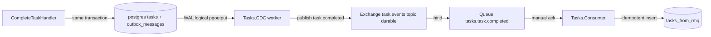

# План: завершение задачи через Outbox + CDC (Npgsql logical replication) → RabbitMQ

> **Статус: реализовано и проверено сквозным прогоном.** План актуален как описание архитектуры.
> В ходе реализации:
> - ручной парсер pgoutput заменён на высокоуровневый API Npgsql
>   (`LogicalReplicationConnection.StartReplication` → типизированные `PgOutputReplicationMessage`),
>   что убрало хрупкий бинарный разбор; подтверждение LSN — `SetReplicationStatus` + `SendStatusUpdate`;
> - health-check RabbitMQ перенесён в CDC (`HealthReporterService`);
> - **исправлен баг:** запись LSN в `cdc_processed` требует явного `NpgsqlDbType.PgLsn`
>   (иначе `InvalidCastException` при параметре `NpgsqlLogSequenceNumber`);
> - добавлен скрипт [`db/migrate.ps1`](../db/migrate.ps1:1) — миграции + подготовка CDC
>   (`-RecreatePostgres` пересоздаёт Postgres с `wal_level=logical` и делает диагностику).
>
> Проверено: `complete` → `outbox_messages` → CDC (logical replication) → RabbitMQ →
> `Tasks.Consumer` → `tasks_from_rmq`; строка в `cdc_processed` подтверждает дедупликацию.

## 1. Контекст и цель

Сейчас завершение задачи публикуется **напрямую** из
[`CompleteTaskHandler`](../src/Tasks/Tasks.Api/Application/Tasks/CompleteTask/CompleteTaskHandler.cs:49)
через [`RabbitMqTaskEventPublisher`](../src/Tasks/Tasks.Api/Messaging/RabbitMqTaskEventPublisher.cs:20)
(fail-silently: если брокер недоступен — сообщение теряется, задача всё равно завершена).

**Цель:** заменить прямую публикацию на паттерн **transactional outbox + CDC**:

1. При завершении задачи API пишет событие в таблицу `outbox_messages` **в той же транзакции**,
   что и изменение строки в `tasks`.
2. Отдельный воркер `src/Tasks/Tasks.CDC` читает WAL через **Npgsql logical replication
   (pgoutput, без Debezium/Kafka)**, декодирует INSERT в outbox и публикует
   `task.completed` в RabbitMQ (exchange `task.events`, routing key `task.completed`).
3. Consumer-сторона (`Tasks.Consumer`) уже существует и идемпотентно пишет в `tasks_from_rmq`.

Итог — гарантированная доставка (at-least-once) без потери событий при недоступности брокера.

## 2. Целевая архитектура



### Гарантии

- **Атомарность**: изменение `tasks` и запись в `outbox_messages` — в одной транзакции
  (`IUnitOfWork.SaveChangesAsync` внутри BEGIN/COMMIT). Событие не может «потеряться»
  между сохранением состояния и записью в outbox.
- **At-least-once**: CDC подтверждает позицию репликации (`confirmed_flush_lsn`) только
  после успешной публикации в Rabbit. При сбое на любом шаге сообщение переопубликуется.
- **Идемпотентность consumer-а**: уже реализована через
  `INSERT ... ON CONFLICT (task_id) DO NOTHING` в `tasks_from_rmq`, поэтому повторная
  доставка безопасна (см. [`plans/rabbitmq-consumer-tasks-from-rmq.md`](rabbitmq-consumer-tasks-from-rmq.md:1)).

## 3. Схема таблицы `outbox_messages`

| Колонка | Тип | Ограничения | Назначение |
|---|---|---|---|
| `id` | `uuid` | PK | Id сообщения (= `TaskId` для идемпотентности события) |
| `event_type` | `varchar(128)` | NOT NULL | Тип события: `task.completed` (= routing key) |
| `payload` | `jsonb` | NOT NULL | Готовый JSON контракта (camelCase, enum строкой) |
| `occurred_at` | `timestamptz` | NOT NULL | Доменное время события (`CompletedAt`) |
| `created_at` | `timestamptz` | NOT NULL, default `now()` | Время записи в outbox (аудит/cleanup) |

- `payload` формируется через общий
  [`JsonSerializationDefaults`](../src/Tasks.Core/Messaging/JsonSerializationDefaults.cs:1) —
  тот же формат, что и у потребителя (единый контракт [`TaskCompletedEvent`](../src/Tasks.Core/Messaging/TaskCompletedEvent.cs:13)).
- Индекс: PK по `id`; `ix_outbox_messages_created_at` для запросов аудита.
- `event_type` позволяет расширять outbox другими событиями в будущем без изменения схемы.

> **Решение:** строки outbox **хранятся для реализации/аудита** — автоматического удаления
> после публикации нет. Таблица служит журналом исходящих событий; при необходимости
> ретенцию можно ограничить отдельной задачей (не входит в текущий объём).

## 4. Изменения в `Tasks.Api`

1. **Сущность** `Data/Outbox/OutboxMessage.cs` — POCO с полями таблицы.
2. **EF-конфигурация** `Data/Configurations/OutboxMessageConfiguration.cs` —
   `IEntityTypeConfiguration<OutboxMessage>`, маппинг на `outbox_messages`,
   PK по `id`, `jsonb` для `payload`.
3. **DbSet** `OutboxMessages` в [`TasksDbContext`](../src/Tasks/Tasks.Api/Data/TasksDbContext.cs:13).
4. **Миграция** `dotnet ef migrations add AddOutboxMessages --project src/Tasks/Tasks.Api`
   (таблица в той же БД `tasks_db`; владелец таблицы — API).
5. **Транзакция в `IUnitOfWork`**: расширить контракт
   [`IUnitOfWork`](../src/Tasks/Tasks.Api/Application/Abstractions/IUnitOfWork.cs:7)
   методом `ExecuteInTransactionAsync(Func<Task> action, CancellationToken)` (или
   `BeginTransactionAsync`), чтобы Application управлял границей, не зная об EF.
   В [`EfUnitOfWork`](../src/Tasks/Tasks.Api/Data/EfUnitOfWork.cs:11) — реализация через
   `DbContext.Database.BeginTransactionAsync`.
6. **`IOutboxWriter`** (Application-абстракция) + `EfOutboxWriter` (Data) —
   `Add(TaskCompletedEvent)` добавляет строку в `OutboxMessages` трекинга.
7. **Переписать** [`CompleteTaskHandler`](../src/Tasks/Tasks.Api/Application/Tasks/CompleteTask/CompleteTaskHandler.cs:14):
   вместо `publisher.PublishTaskCompletedAsync` — в одной транзакции сохранить задачу
   и добавить событие в outbox:
   ```
   try {
     await unitOfWork.ExecuteInTransactionAsync(async () => {
       item.Complete(clock.GetUtcNow());
       outbox.Add(item.DomainEvents.OfType<TaskCompletedDomainEvent>()
                      .Select(e => e.ToIntegrationEvent()));
       await unitOfWork.SaveChangesAsync(ct);
     }, ct);
   } catch (ConcurrencyConflictException) { ... 409 ... }
   ```
   Маппинг доменного события в `TaskCompletedEvent` берём из
   [`TaskDomainEventMapper`](../src/Tasks/Tasks.Api/Messaging/TaskDomainEventMapper.cs:11).
8. **Прямая публикация**: `ITaskEventPublisher`/`RabbitMqTaskEventPublisher` больше
   не используется в пути complete.
9. **Readiness-проверка RabbitMQ переносится из API в CDC**: убрать `AddRabbitMQ`
   из [`Program.cs`](../src/Tasks/Tasks.Api/Program.cs:72) (API больше не публикует в брокер),
   а в проекте `Tasks.CDC` добавить health-check RabbitMQ (и, опционально, статус слота
   репликации). Регистрация `RabbitMqTaskEventPublisher`/`IBrokerHealthProbe` в API
   удаляется ([`ServiceCollectionExtensions`](../src/Tasks/Tasks.Api/Extensions/ServiceCollectionExtensions.cs:36)).

## 5. Новый проект `src/Tasks/Tasks.CDC`

Структура (Worker, net10.0):

```text
src/Tasks/Tasks.CDC/
  Tasks.CDC.csproj              (Sdk.Worker; Npgsql, RabbitMQ.Client, Serilog, HealthChecks.Rabbitmq)
  Program.cs                    (CdcProgram.Main: Build + EnsureReplicationSetup + Run)
  CdcHost.cs                    (композиционный корень + Serilog + health-checks)
  HealthReporterService.cs      (периодический readiness-отчёт RabbitMQ в лог)
  appsettings.json
  Replication/
    ReplicationOptions.cs       (ConnectionString, SlotName, PublicationName, OutboxTable, ReconnectDelaySeconds)
    PublicationInitializer.cs   (CREATE PUBLICATION на outbox_messages)
    LogicalReplicationReader.cs (LogicalReplicationConnection + PgOutputReplicationSlot + StartReplication + SendStatusUpdate)
    ReplicationPositionStore.cs (таблица cdc_processed: дедупликация (lsn, outbox_id))
    OutboxInsertDecoder.cs      (InsertMessage -> TaskCompletedEvent, дедупликация payload)
  Messaging/
    RabbitMqOptions.cs          (Host/Port/User/Password/VHost/Exchange/ShutdownDrainTimeoutSeconds)
    IEventPublisher.cs          (абстракция публикации)
    RabbitMqPublisher.cs        (publish task.completed, persistent, MessageId=TaskId)
  Extensions/
    HostExtensions.cs           (EnsureReplicationSetupAsync: публикация + cdc_processed)
  CdcWorker.cs                  (BackgroundService: stream -> decode -> publish -> confirm LSN)
```

Регистрация проекта в [`Tasks.slnx`](../src/Tasks/Tasks.slnx:1) по аналогии с Consumer.

### Ключевые компоненты

- **`LogicalReplicationReader`** — использует высокоуровневый API Npgsql:
  `LogicalReplicationConnection` + `CreatePgOutputReplicationSlot` + `StartReplication`
  (IAsyncEnumerable типизированных `PgOutputReplicationMessage`), подтверждение —
  `SetReplicationStatus` + `SendStatusUpdate`.
- **`OutboxInsertDecoder`** — принимает типизированное `InsertMessage`, собирает значения
  колонок по именам (тети-итератор `ReplicationTuple`) и десериализует `payload` (jsonb)
  в `TaskCompletedEvent`. Ручной бинарный разбор pgoutput не требуется (его делает Npgsql).
- **Дедупликация в CDC** — нужна дедупликация по ключу **(`Lsn`, `id`)**. Ведём
  локальное хранилище/кэш уже обработанных пар (например, таблица `cdc_processed` в БД
  или переиспользование `tasks_from_rmq`-подобной таблицы), чтобы повторная обработка
  одного и того же WAL-изменения (при реконнекте/переигрывании LSN) не приводила к
  повторной публикации. Ключ (`decoded_lsn`, `outbox_id`) уникален.
- **`CdcWorker`** — оркестрация: читает поток, декодирует, публикует в Rabbit,
  и **только после успешной публикации** отправляет подтверждение позиции (standby status update / confirm LSN).
- **`RabbitMqPublisher`** — публикация в exchange `task.events` (topic, durable),
  routing key из `event_type`, `DeliveryMode=Persistent`, `MessageId=TaskId`.
  Использует общий [`TaskCompletedEvent`](../src/Tasks.Core/Messaging/TaskCompletedEvent.cs:13).

### Надёжность

- Подтверждение LSN продвигается после успешной публикации (at-least-once).
- Авто-реконнект к слоту при обрыве; обработка `restart_lsn`/`confirmed_flush_lsn`.
- Graceful shutdown: по `CancellationToken` прекратить чтение, закрыть поток и соединения
  (по образцу [`RabbitMqTaskEventPublisher.DisposeAsync`](../src/Tasks/Tasks.Api/Messaging/RabbitMqTaskEventPublisher.cs:189)).
- Дедупликация по (`Lsn`, `id`) исключает повторную публикацию при переигрывании WAL.
- Health-check RabbitMQ (и статус слота) живёт в CDC (см. п. 4 и п. 10).

## 6. Инфраструктура и конфигурация

- **Postgres**: включить `wal_level=logical` (параметр `command: ["postgres","-c","wal_level=logical"]`
  или `postgresql.conf`) в [`db/docker-compose.yml`](../db/docker-compose.yml:8).
  Требуется `max_replication_slots >= 1` и `max_wal_senders >= 1` (значения по умолчанию обычно достаточны).
- **Права**: выдать право `REPLICATION` **текущему пользователю `tasks_user`**
  (`ALTER ROLE tasks_user WITH REPLICATION;`). Отдельная роль не заводится.
  Добавить выдачу в [`db/init/01-init.sql`](../db/init/01-init.sql:1), чтобы применялось
  автоматически при инициализации контейнера.
- **`.env` / `.env.example`**: добавить секцию `Cdc` (`Cdc__SlotName`, `Cdc__PublicationName`,
  `Cdc__ConnectionString` при необходимости) и при необходимости `RABBITMQ__*` уже есть.
- **`appsettings.json`** проекта CDC: `ConnectionStrings:Postgres`, `RabbitMq:*`,
  `Cdc:SlotName` (default `tasks_outbox_slot`), `Cdc:PublicationName` (default `tasks_outbox_pub`),
  `Logs:Directory`, Serilog.

## 7. Скрипт запуска

- Создать `src/run_CDC.ps1` по образцу
  [`run_Tasks.ps1`](../src/run_Tasks.ps1:1)/[`run_Consumer.ps1`](../src/run_Consumer.ps1:1):
  чтение корневого `.env`, сборка, запуск `dotnet run --project src/Tasks/Tasks.CDC`,
  вывод слота/публикации и подсказок по management UI.

## 8. Тесты

- **Unit — `CompleteTaskHandlerTests`**: заменить проверку `publisher.Events` на проверку
  записи в outbox (фейковый `IOutboxWriter`/`FakeUnitOfWork` вместо `RecordingTaskEventPublisher`).
- **Unit — `PgOutputDecoder`**: тесты на бинарных фикстурах сообщений pgoutput
  (`Begin`/`Relation`/`Insert`/`Commit`) → корректное декодирование в `TaskCompletedEvent`.
- **Integration/E2E**: адаптировать [`CompleteToConsumerE2ETest`](../src/Tasks/Tasks.Tests/CompleteToConsumerE2ETest.cs:28)
  под новый путь: API создаёт+завершает задачу → строка в `outbox_messages` →
  `Tasks.CDC` публикует → consumer пишет в `tasks_from_rmq`.
  Запускать CDC-хост программно (как `ConsumerHost`) с реальной БД/RabbitMQ.
- **Cleanup/идемпотентность**: повторная публикация не создаёт дубль в `tasks_from_rmq`.

## 9. Порядок выполнения

См. todo-список (15 пунктов): от дизайна схемы и outbox-таблицы до CDC-парсера,
публикации, инфраструктуры, тестов и документации.

## 10. Принятые решения

- **Cleanup `outbox_messages`**: строки **хранятся** (журнал исходящих событий для реализации/аудита).
  Автоматического удаления после публикации нет; при необходимости ретенция ограничивается
  отдельной задачей (вне текущего объёма).
- **Readiness-проверка RabbitMQ**: **переносится из API в CDC**. Убираем `AddRabbitMQ` из
  [`Program.cs`](../src/Tasks/Tasks.Api/Program.cs:72) и регистрацию publisher/`IBrokerHealthProbe`
  в API; в `Tasks.CDC` добавляем health-check RabbitMQ (и статус слота репликации).
- **Права БД**: право `REPLICATION` выдаётся **текущему пользователю `tasks_user`**
  (`ALTER ROLE tasks_user WITH REPLICATION;` в [`db/init/01-init.sql`](../db/init/01-init.sql:1)).
- **Формат `payload`**: готовый JSON контракта (camelCase, enum строкой) — меньше дублирования логики.
- **Дедупликация в CDC**: **вводится**, ключ (**`Lsn`**, **`id`**) — защита от повторной публикации
  при реконнекте/переигрывании WAL (см. п. 5 и todo-пункт 11).
