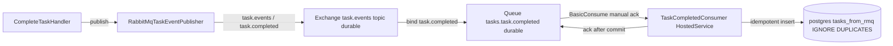

# План: идемпотентный подписчик RabbitMQ + таблица `tasks_from_rmq`

## 1. Контекст и цель

Сейчас `Tasks.Api` — **только publisher**. При завершении задачи
[`CompleteTaskHandler`](../src/Tasks/Tasks.Api/Application/Tasks/CompleteTask/CompleteTaskHandler.cs:49)
публикует `TaskCompletedEvent` в обменник `task.events` (routing key `task.completed`)
через [`RabbitMqTaskEventPublisher`](../src/Tasks/Tasks.Api/Messaging/RabbitMqTaskEventPublisher.cs:19).
Consumer-стороны нет: очередь/биндинг/подписка не создаются, сообщения уходят «в никуда».

**Цель:** добавить потребителя, который забирает события `task.completed` из RabbitMQ
и **идемпотентно** пишет их в отдельную таблицу `tasks_from_rmq` в PostgreSQL.

Ключевые требования:
- идемпотентность — повторная доставка одного и того же события (at-least-once)
  не должна создавать дубликаты и не должна падать;
- устойчивость — ручная `ack` только после успешной записи в БД; при ошибке — `nack`/retry;
- очередь должна объявляться самим consumer-ом (durable + привязка к `task.events` по `task.completed`).

## 2. Архитектурное решение

Реализуем consumer как **отдельный Worker-проект** `src/Consumer/Tasks.Consumer`
(hosted service `BackgroundService` внутри собственного процесса). Причины:
- изоляция нагрузки consumer-а от API (prefetch, long-running подписка);
- независимый деплой/масштабирование и отдельный запуск (`run_Consumer.ps1`);
- отдельный процесс — независимая конфигурация `RabbitMq`/`ConnectionStrings`.

Проект **подключается к той же базе PostgreSQL**, что и `Tasks.Api`
(`ConnectionStrings__Postgres` из общего `.env`), и разделяет схему таблицы
`tasks_from_rmq`. Миграцию создаёт consumer-проект (владелец этой таблицы),
применение миграций — на старте consumer-а (флаг `Db:MigrateOnStartup`).



### Идемпотентность

Два уровня защиты:

1. **Естественный ключ** — `task_id` как `PRIMARY KEY`. Повторная вставка того же
   события нарушает PK.
2. **`INSERT ... ON CONFLICT (task_id) DO NOTHING`** (EF Core: `Npgsql` + ручной SQL
   либо предварительная проверка `AnyAsync`). Предпочтителен `ON CONFLICT DO NOTHING` —
   атомарно, без гонок между воркерами.
   Дополнительно можно хранить `message_id` (MessageId из AMQP-свойств = `TaskId`)
   и `processed_at` для аудита.

Порядок обработки сообщения:
1. десериализовать `TaskCompletedEvent` (camelCase, enum-ы строками);
2. `INSERT ... ON CONFLICT DO NOTHING` в `tasks_from_rmq`;
3. `SaveChanges`/commit;
4. `BasicAck` — только после успешного commit.

При исключении на шагах 1–3: `BasicNack` без requeue (или requeue с лимитом попыток) —
сообщение уходит в DLQ либо лог, но не зацикливается бесконечно.

## 3. Схема таблицы `tasks_from_rmq`

| Колонка | Тип | Ограничения | Назначение |
|---|---|---|---|
| `task_id` | `uuid` | PK | Id задачи (= AMQP `MessageId`), естественный ключ идемпотентности |
| `title` | `varchar(200)` | NOT NULL | Заголовок из события |
| `priority` | `varchar(16)` | NOT NULL | Low/Medium/High (строкой, как в домене) |
| `completed_at` | `timestamptz` | NOT NULL | Время завершения из события |
| `processed_at` | `timestamptz` | NOT NULL | Время записи consumer-ом (аудит/диагностика) |
| `routing_key` | `varchar(128)` | NULL | Routing key сообщения (диагностика) |
| `raw_payload` | `jsonb` | NULL | Оригинальное тело сообщения для разбора инцидентов |

Индекс: PK по `task_id` (он же уникальный). При необходимости — индекс по `processed_at`.

> Примечание: `message_id` можно не дублировать отдельной колонкой, т.к. в текущей
> публикации `MessageId == TaskId`. Если формат изменится, стоит добавить `message_id uuid`.

## 4. Структура нового проекта `src/Consumer`

```
src/Consumer/
  Tasks.Consumer.slnx                     (или добавление в общий slnx)
  (скрипт запуска живёт в src/run_Consumer.ps1)
  Tasks.Consumer/
    Tasks.Consumer.csproj                 (Microsoft.NET.Sdk.Worker, net10.0)
    Program.cs                            (Host + Serilog + DI + миграции)
    appsettings.json
    Properties/launchSettings.json        (опционально)
    Data/
      ConsumerDbContext.cs                (EF Core контекст: TasksFromRmq)
      Configurations/TaskFromRmqConfiguration.cs
      TaskFromRmq.cs                       (сущность)
      TaskFromRmqRepository.cs             (идемпотентный INSERT ... ON CONFLICT)
      Migrations/                          (EF-миграции: владелец таблицы)
    Messaging/
      RabbitMqOptions.cs                   (Host/Port/User/.../Exchange/RoutingKey/Queue/Prefetch)
      TaskCompletedEvent.cs                (контракт сообщения, camelCase, enum строкой)
      TaskCompletedConsumer.cs             (BackgroundService: consume + manual ack)
  Tasks.Consumer.Tests/                    (опционально)
```

### Data-слой (в consumer-проекте)
- **Сущность** `Data/TaskFromRmq.cs` — POCO/record с полями таблицы.
- **Конфигурация** `Data/Configurations/TaskFromRmqConfiguration.cs` — `IEntityTypeConfiguration<TaskFromRmq>`,
  маппинг на `tasks_from_rmq`, PK по `task_id`, `priority` через `HasConversion<string>()`.
- **`ConsumerDbContext`** — `DbSet<TaskFromRmq> TasksFromRmq`, `ApplyConfigurationsFromAssembly`.
- **Миграция EF** — `dotnet ef migrations add AddTasksFromRmq --project src/Consumer/Tasks.Consumer`
  (таблица + PK). Сама таблица создаётся в той же БД `tasks_db`.
- **Репозиторий** `Data/TaskFromRmqRepository.cs` — `Task<bool> TryInsertAsync(TaskCompletedEvent, CancellationToken)`,
  внутри `INSERT INTO tasks_from_rmq (...) VALUES (...) ON CONFLICT (task_id) DO NOTHING`
  через `ExecuteSqlInterpolatedAsync`; результат `0/1` говорит, был ли дубликат.

### Messaging / Consumer
- **`Messaging/TaskCompletedConsumer.cs`** — `BackgroundService`:
  - на старте: `ConnectionFactory` по `RabbitMqOptions`;
    `ExchangeDeclareAsync(task.events, topic, durable)`,
    `QueueDeclareAsync(queue: "tasks.task.completed", durable: true, exclusive: false, autoDelete: false)`,
    `QueueBindAsync(queue, task.events, "task.completed")`;
  - `BasicQosAsync(prefetchCount)` для контролируемой нагрузки;
  - `BasicConsumeAsync` с **manual ack** (`autoAck: false`);
  - на каждое сообщение: deserialize → `TryInsertAsync` → `BasicAckAsync`;
  - при ошибке deserialize/SQL: лог + `BasicNackAsync(requeue: false)` (без бесконечного цикла);
  - graceful shutdown: `CancellationToken` от хоста, корректное закрытие канала/соединения
    (по аналогии с [`RabbitMqTaskEventPublisher.DisposeAsync`](../src/Tasks/Tasks.Api/Messaging/RabbitMqTaskEventPublisher.cs:185));
  - автореконнект: `AutomaticRecoveryEnabled = true`.
- **`Messaging/RabbitMqOptions.cs`** — Host/Port/User/Password/VirtualHost/Exchange/RoutingKey
  + `Queue` (default `tasks.task.completed`), `PrefetchCount` (default 10).

### Регистрация и хостинг
- **`Program.cs`** — `Host.CreateApplicationBuilder`, `AddDbContext<ConsumerDbContext>`,
  `AddScoped<TaskFromRmqRepository>()`, `AddHostedService<TaskCompletedConsumer>()`,
  Serilog (консоль + файл в общий `LOGS_DIR`, как в API),
  применение миграций на старте (`Db:MigrateOnStartup`, по умолчанию `true`).

### Конфигурация
- **`src/Consumer/Tasks.Consumer/appsettings.json`** — `ConnectionStrings:Postgres`,
  секция `RabbitMq` (+ `Queue`, `PrefetchCount`), `Logs:Directory`, `Db:MigrateOnStartup`.
- **`.env.example`** — при необходимости `RABBITMQ__QUEUE`, `RABBITMQ__PREFETCHCOUNT`.
  Consumer запускается тем же `.env`, что и API (порт RabbitMQ 5673, порт Postgres 5442).

## 5. Тесты

- **Unit** — идемпотентность репозитория: два `TryInsertAsync` с одним `TaskId` →
  первый возвращает `true`, второй `false`, в БД одна строка
  (через Testcontainers.PostgreSql, как в [`CompleteTaskIntegrationTest`](../src/Tasks/Tasks.Tests/CompleteTaskIntegrationTest.cs:33)).
- **Integration** — публикуем событие в реальный RabbitMQ (Testcontainers) и проверяем,
  что consumer записал строку в `tasks_from_rmq`; публикуем повторно — строк по-прежнему одна.
- **Fallback-режим** (нет Docker): тестируем репозиторий на in-memory/SQLite либо
  пропускаем сквозной сценарий, сохранив текущую деградацию тестов.

## 6. Порядок выполнения

1. Создать Worker-проект `src/Consumer/Tasks.Consumer` (net10.0, SDK.Worker),
   добавить в решение, настроить `appsettings.json` и Serilog.
2. Описать сущность `TaskFromRmq`, EF-конфигурацию, `ConsumerDbContext`, сгенерировать миграцию.
3. Реализовать репозиторий с `ON CONFLICT DO NOTHING`.
4. Реализовать `RabbitMqOptions` и `TaskCompletedConsumer` (BackgroundService, manual ack, реконнект, shutdown).
5. Зарегистрировать DbContext, репозиторий и hosted service в `Program.cs`.
6. Создать `src/run_Consumer.ps1` по аналогии с [`run_Tasks.ps1`](../src/run_Tasks.ps1:1)
   (чтение `.env`, сборка, запуск `dotnet run`; вывод очереди/exchange и подсказки по management UI).
7. Дополнить `appsettings.json` и `.env.example`.
8. Написать unit- и интеграционные тесты идемпотентности и доставки.
9. Прогнать сборку, тесты, ручная проверка через management UI (`http://localhost:15673`).

## 7. Запуск и проверка

- `run_Consumer.ps1` читает тот же корневой `.env` (RabbitMQ 5673, Postgres 5442) и запускает
  `dotnet run --project src/Consumer/Tasks.Consumer`.
- Проверка: завершить задачу через API → событие попадает в очередь `tasks.task.completed`
  → consumer пишет строку в `tasks_from_rmq`; повторная публикация не создаёт дубль.
- В management UI (`http://localhost:15673`) должны появиться очередь и 1 consumer.

## 8. Открытые вопросы

- Поведение при устойчивой ошибке обработки: DLQ или `nack` без requeue + лог? *(по умолчанию — nack без requeue)*
- Нужна ли отдельная колонка `message_id` (если MessageId перестанет совпадать с TaskId)?
- Нужен ли unique-констрейнт на `(task_id, message_id)` вместо/в дополнение к PK по `task_id`?
- Хранить ли весь `raw_payload` (jsonb) или достаточно структурных колонок?
- Нужно ли выносить контракт `TaskCompletedEvent` в общий shared-проект? *(в плане — дублирование контракта, чтобы не плодить зависимости)*
